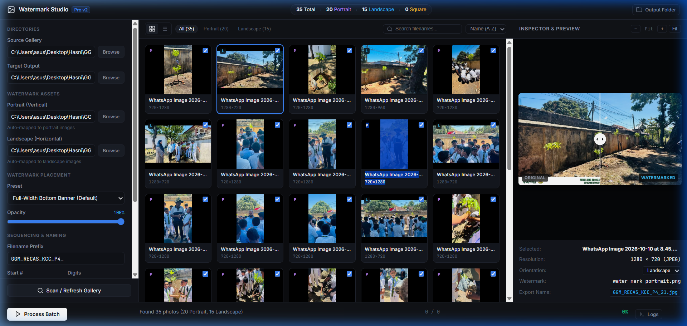

# Watermark Studio Pro V2

Professional, local-first batch watermarking and orientation classification software for photography projects.



---

## 1. Overview
Watermark Studio Pro V2 is designed for school and event photography workflows. It handles hundreds of photos with automatic EXIF orientation detection, dynamic orientation-specific watermark compositing, real-time before/after comparison preview, collision-free batch file renaming, and safe atomic file exports.

---

## 2. Key Features

- **Smart Orientation Detection**:
  - Automatically reads EXIF orientation using `ImageOps.exif_transpose`.
  - Classifies photos into **Portrait** (`height > width`), **Landscape** (`width > height`), and **Square** (`width == height`).
  - Allows manual per-photo orientation override in the inspector.
- **Accurate Watermark Mapping & Scaling**:
  - **Portrait photos** map to vertical watermark canvas (`water mark landscape.png`, 900×1600).
  - **Landscape photos** map to horizontal watermark canvas (`water mark portrait.png`, 1600×900).
  - Full-width bottom banner preset automatically scales the banner proportionally to the photo's width and positions it flush at the bottom.
  - Multi-mode support: Full-width bottom banner, Original proportional overlay, or Custom scale/alignment/margins.
  - Smooth alpha compositing and opacity control (10% to 100%).
- **Interactive Live Preview**:
  - Draggable Before/After comparison slider.
  - Zoom controls: Fit, 100%, Zoom In (+), Zoom Out (-).
  - Live inspector showing photo dimensions, orientation, watermark applied, and target export name.
- **Deterministic Batch Renaming & Collisions**:
  - Customizable prefix (default: `GGM_RECAS_KCC_P4_`).
  - Sequence options: Continuous across all photos (`01` to `35`) or separate sequence per folder (`01`–`20` & `01`–`15`).
  - Automatic collision resolution prevents duplicate names or accidental overwrites.
  - Illegal Windows character sanitization (`/ \ : * ? " < > |`).
- **Safe Local Exporting**:
  - Never modifies or deletes source photos.
  - Writes to `.tmp` files first followed by atomic replacement.
  - Automatically excludes the target output directory during scans to avoid recursive loops.
  - Converts RGBA to JPEG with clean background flattening (no dark fringing).
- **Batch Job Engine**:
  - Multi-threaded background execution (never freezes browser).
  - Pause, Resume, and Cancel support.
  - Per-file progress tracking, log terminal, and one-click "Open Output Folder".

---

## 3. Watermark Asset Mapping

The watermark files provided in `Water mark/`:
| Asset File Name | Canvas Dimensions | Orientation | Photo Target |
| :--- | :--- | :--- | :--- |
| `water mark landscape.png` | 900 × 1600 | Vertical (9:16) | **Portrait photos** |
| `water mark portrait.png` | 1600 × 900 | Horizontal (16:9) | **Landscape photos** |

---

## 4. Installation & Requirements

- **Operating System**: Windows 10 / 11 (64-bit)
- **Python**: Python 3.10 or later
- **Dependencies**:
  ```bash
  pip install -r requirements.txt
  ```
  *(Flask >= 2.0.0, Pillow >= 9.0.0)*

---

## 5. Launch Instructions

### Option A: 1-Click Windows Launcher (Recommended)
Double-click:
```
Launch_Watermark_Studio.bat
```
The script will verify your Python environment, check dependencies, launch the local server, and open your browser automatically at `http://127.0.0.1:5000`.

### Option B: Command Line
```bash
cd "Part 4 Gallery\WatermarkStudio"
python app.py
```
Then open `http://127.0.0.1:5000` in your web browser.

---

## 6. Directory Structure

```
Part 4 Gallery/
├── Gallery/                      <- Unedited source photos
│   ├── Portrait/
│   └── Landscape/
├── Water mark/                   <- Original watermark PNG assets
│   ├── water mark landscape.png  (900x1600 vertical canvas)
│   └── water mark portrait.png   (1600x900 horizontal canvas)
├── Watermarked Gallery/          <- Export destination
│   ├── Portrait/
│   └── Landscape/
├── Launch_Watermark_Studio.bat   <- One-click desktop launcher
└── WatermarkStudio/
    ├── app.py                    <- Flask API & entry point
    ├── requirements.txt          <- Python package dependencies
    ├── config.json               <- Persistent user settings
    ├── README.md                 <- System documentation
    ├── services/
    │   ├── __init__.py
    │   ├── settings.py           <- Preferences & presets manager
    │   ├── file_manager.py       <- Safe paths, naming & atomic writes
    │   ├── watermark.py          <- Core compositing & banner engine
    │   ├── image_processor.py    <- EXIF normalization, cache & export
    │   └── job_manager.py        <- Background batch job controller
    ├── templates/
    │   └── index.html            <- Modern 3-column studio UI
    ├── static/
    │   ├── css/style.css         <- Dark creative-tool styling
    │   └── js/app.js             <- Client-side application logic
    └── tests/
        ├── __init__.py
        └── test_watermark_studio.py <- Automated test suite (15 tests)
```

---

## 7. Running Automated Tests

Run the automated test suite anytime using:
```bash
python tests/test_watermark_studio.py
```
Test coverage includes:
- EXIF normalization
- Portrait/Landscape/Square classification
- Correct watermark asset mapping
- Full-width bottom banner compositing
- Opacity control and alpha blending
- Sequential numbering and collision avoidance
- Windows filename sanitization
- Corrupt image resilience
- Nested output directory exclusion
- Safe atomic file replacement
- Real watermark assets integrity
- Background job cancellation
- Geometry equivalence between preview and export
- RGBA to JPEG background color flattening
- Settings persistence

---

## 8. Troubleshooting

- **Port 5000 already in use**:
  If another process is using port 5000, close any existing background terminal running `app.py` or modify the port variable in `app.py`.
- **Images appearing sideways**:
  Watermark Studio automatically respects EXIF rotation tags. If an image lacks standard EXIF tags, you can manually switch its orientation directly in the Inspector dropdown.
- **Browser does not open automatically**:
  Navigate directly to `http://127.0.0.1:5000` in Google Chrome, Microsoft Edge, or Mozilla Firefox.
